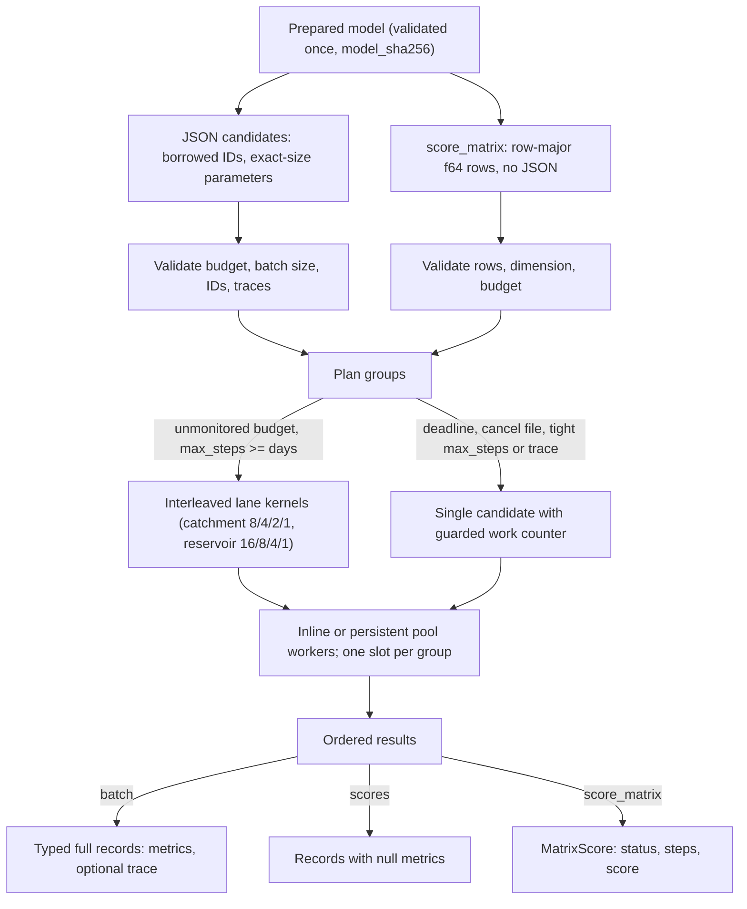

# Hydro Craft architecture

Version 0.3.0. Calibrate a synthetic HBV-style daily catchment and compare
non-anticipatory policies for one reservoir. This document describes the
engine as built and reports measured performance. The
[user manual](user-manual.md) is the reference for using it.

## Evaluation pipeline

| Boundary | Location | Responsibility |
| --- | --- | --- |
| Request and CLI | `src/main.rs`, `src/lib.rs` (`run`, `capabilities`), `models/request.json` | Versioned request schema, exact model-byte hash, typed validation, sorted-key JSON output and exit code |
| Python boundary | `python/hydro_craft/__init__.py`, PyO3 module in `src/lib.rs` | `batch` and `scores` encode once per batch and decode one result; `score_matrix` passes lists of floats and returns three lists. The GIL is released during native evaluation |
| Prepared engine | `src/lib.rs` | Own the immutable model, enforce batch rules, plan groups, dispatch them and assemble ordered records or matrix scores |
| Worker pool | `src/pool.rs` | Persistent helper threads shared by all batches of a process |
| Domain | `src/domain.rs` | Validate models and parameters, run scalar and interleaved kernels, classify status, compute the objective and typed metrics |
| Campaign | `python/hydro_craft/campaign.py` | Local SQLite replay, attempt journal and complete-result caching |
| Verification | `validation/`, `examples/`, `evidence/` | Independent checks, paired performance comparisons, executable examples and raw measurements |

## Data and execution contracts

`Prepared::new` hashes the model bytes, deserializes the model and
validates its bounds; preparation also tags every catchment day with its
fold. The Python wrapper encodes models with sorted keys and finite JSON
numbers. Two inputs that differ in their serialized representation can
have different provenance hashes. Result and request schema tags remain at
0.1; the package version is reported separately. The matrix API is not
part of the JSON schema.

Every JSON batch validates the budget (workers 1-64, `max_steps`
1-100,000,000, `wall_ms` 1-86,400,000), the candidate count (1-4,096),
unique IDs of 1-128 bytes, parameter vectors of at most 64 values and at
most 16 traced candidates. Candidate IDs are borrowed from the request
text unless the JSON string has escapes, and each parameter array is read
into a 64-value stack buffer and copied once into an exactly sized vector.
Error messages are those of the plain serde derive used before.

`score_matrix(rows, parameters, budget)` takes row-major parameters with
`parameters.len() / rows` values per row (dimension 0 allowed) and
rejects rows outside 1-4,096, a length that is not a multiple of `rows`,
a dimension above 64 and an invalid budget. Rows have no IDs and need no
duplicate check. Every row reports the same status, steps and
bit-identical score as `scores_json` for the same parameters; unit tests
check this for invalid rows, `max_steps` limits, a cancel file, deadlines
and several workers. The PyO3 method takes `Vec<Vec<f64>>`, rejects
ragged rows and returns scores with NaN for every row that is not
complete.

`Work` counts one logical step per simulated day. When no deadline or
cancel file is monitored and `max_steps` covers every day, no candidate
can stop early: each one either fails validation before its first step or
simulates all days. Only then does the engine group untraced candidates
for the interleaved kernels and charge each valid one the full day count
in bulk. Otherwise every candidate runs alone through `Work::step`, whose
fast branch handles unmonitored steps below the limit and whose guarded
branch checks the cancel file, then the deadline, then the step budget.
Cancellation and deadlines are cooperative; fixed-work results are
independent of worker count and grouping.

Dispatch splits the batch into consecutive groups (8 catchment or 16
reservoir candidates for the lane path, 1 otherwise). One worker, or a
single group, runs inline. Otherwise the calling thread and up to
`workers - 1` helpers from a process-wide pool claim groups through an
atomic cursor; each group owns one result slot, written once, and results
are flattened in input order. Pool helpers are created on demand (at most
63), wait on a condition variable between batches and are shared by
concurrent batches; the calling thread always works on its own batch, so
a batch progresses even when every helper is busy. A panic in any
participant is propagated to the caller after all participants have
left the batch. A forked child process starts a fresh pool.

Full records serialize typed metrics structs whose fields are declared in
sorted key order, so the JSON text equals the sorted `serde_json::Value`
maps of earlier releases; the CLI converts the typed batch to a `Value`.
`scores_json` in Rust and `Prepared.scores` in Python return the same
record keys with null metrics and reject traced candidates. All result
levels keep per-candidate limits, the diagnostics needed for feasibility,
the finite-score check and the failure status.

## Domain internals

| Model | Fixed at preparation | Candidate-local computation |
| --- | --- | --- |
| Catchment | Area, daily forcing, observations and a fold tag per day | Snow accumulation and melt, soil recharge, evapotranspiration, upper and lower stores, runoff, fold scores and the daily balance |
| Reservoir | Capacity, reserve, outlet and daily inputs | Prior-storage release rule, evaporation, delivery, release, spill, shortage statistics and the daily balance |

Each model has one set of step functions shared by the scalar path and the
lane kernels, so every candidate performs the same floating-point
operations in the same order on either path and results are bit-identical.
The catchment day is composed of `day_start` (store total for the
balance), `freeze` or `thaw` (snow and recharge) and `day_finish`
(overflow, evapotranspiration, percolation, recession and the balance),
followed by `score_day`. The reservoir day is one `reservoir_day`.

The lane kernels advance `L` independent candidates day by day over the
shared inputs. Their update chains do not depend on each other, so the
processor overlaps them; a single catchment or reservoir candidate is a
latency-bound recurrence of about 19-21 ns per day on the test host. The
catchment kernel takes the frozen or thawed branch once per day for the
whole group. Candidates are partitioned by recharge exponent: exactly 1
or 2 use a branch-free thawed step that computes recharge and selects
zero on days without liquid water (the value the scalar path produces by
skipping the computation) and run up to eight lanes; other exponents keep
the per-lane check that skips the power call and run up to four lanes.
Lean reservoir groups run up to sixteen lanes and full ones up to eight,
because the shortage-streak and balance state of full records did not
benefit from wider groups. Shortage streaks are counted branch-free.

Lean catchment scores accumulate only the training fold; lean reservoir
scores skip shortage streaks and the balance. Both simulate every day and
apply the same input, work and cancellation rules. The daily water
balance is a full-record diagnostic and is independently validated. Both
modes carry warm-up stores into the scored days. Traced candidates always
use the scalar path and write typed day rows into a vector preallocated
to the number of days. See the [model card](model.md) for units and the
limited synthetic calibration scope.

## Structural changes in 0.3.0

| Round | Change |
| ---: | --- |
| 1 | Typed score-matrix API in Rust and Python, sharing dispatch with the JSON path |
| 2 | Persistent worker pool instead of per-batch scoped threads |
| 3 | Typed full-record metrics instead of `serde_json::Value` maps |
| 4 | Typed, preallocated trace rows |
| 5 | Interleaved reservoir lanes behind the shared `reservoir_day` step |
| 6 | Interleaved catchment lanes behind shared step functions |
| 7 | Borrowed candidate IDs and exact-size parameter vectors |
| 8 | Per-day temperature branch for the whole group and exponent-class catchment kernels |
| 9 | Sixteen lanes for lean reservoir scoring |
| 10 | Eight lanes for full catchment records of a known exponent class |

A feature-gated hook (`profiling`, `Prepared::profile_json`) and
`examples/breakdown.rs` time JSON calls by phase. The
[0.3.0 performance log](../hydro-craft-performance-log-0.3.0.md) lists
each round's measured effect and the rejected attempt.

## Persistence and boundaries of evidence

The local campaign hashes the installed extension bytes plus each
scenario, model, candidate and work settings to locate reusable records.
SQLite stores completed, invalid and infeasible results and keeps an
append-only journal of attempts. Canceled or time-limited attempts remain
in the journal and can be retried. SQLite commits each chunk atomically.
A new extension build changes the cache namespace. The workflow is local
and exposes no distributed worker protocol.

The package contains source, a source distribution and a validated Linux
x86-64 wheel. See the [user manual](user-manual.md) and the
[tutorial](tutorial.md) for commands and [the model card](model.md) for
equations and research scope.

## Performance

All numbers in this section were measured on one host: 2 vCPUs, Intel(R)
Xeon(R) Processor @ 2.10GHz (KVM), Rust 1.97.0 and CPython 3.12.3, with
every timing run inside a lock that kept builds and other timings off the
CPUs. The 0.2.0 performance log's numbers came from another host (AMD
EPYC 9V74, 4 CPUs, Rust 1.88) and are not comparable with these. Raw
data are in [`evidence/performance-0.3.0/`](../evidence/performance-0.3.0/README.md).

### 0.2.0 to 0.3.0

Median milliseconds per prepared call from
`validation/performance_pair.py --samples 11`, pairing the 0.2.0 baseline
benchmark binary with the round 10 binary
([`cumulative/`](../evidence/performance-0.3.0/cumulative/)). Times
exclude process start-up and model preparation and include JSON decode,
evaluation and JSON encode (matrix rows: no JSON). The `parallel` workload
keeps its four requested workers on this 2-vCPU host. Matrix rows compare
0.2.0 lean scores with 0.3.0 matrix calls, because 0.2.0 has no matrix
API. Outputs of both binaries are byte-identical for every workload.

Host: 2 vCPUs, Intel(R) Xeon(R) Processor @ 2.10GHz (KVM), Rust 1.97.0, CPython 3.12.3.

| Workload | Case | 0.2.0 ms | 0.3.0 ms | 0.2.0 / 0.3.0 |
| --- | --- | ---: | ---: | ---: |
| `one` | Single full record (90 days) | 0.005 | 0.003 | 1.55x |
| `serial` | 96 full records, one worker | 0.482 | 0.163 | 2.96x |
| `parallel` | 96 full records, four workers requested | 0.611 | 0.179 | 3.41x |
| `trace` | 12 traced full records | 1.714 | 0.330 | 5.19x |
| `invalid` | 1,024 invalid candidates (63 parameters) | 1.410 | 1.259 | 1.12x |
| `domain` | 48 catchment records, 2,400 days | 2.819 | 0.781 | 3.61x |
| `domain2` | 48 reservoir records, 2,400 days | 2.490 | 0.804 | 3.10x |
| lean `serial` | 96 lean scores | 0.224 | 0.084 | 2.66x |
| lean `domain` | 48 lean catchment scores | 2.488 | 0.511 | 4.87x |
| lean `domain2` | 48 lean reservoir scores | 2.372 | 0.396 | 5.99x |
| matrix `serial` | 96 matrix scores (0.2.0: lean) | 0.234 | 0.045 | 5.18x |
| matrix `domain` | 48 catchment matrix scores (0.2.0: lean) | 2.475 | 0.493 | 5.03x |

### Where a call's time goes

Median microseconds of 201 calls per row from `examples/breakdown.rs`
([`breakdown.json`](../evidence/performance-0.3.0/breakdown.json)).
Decode covers candidates and budget; evaluate covers validation,
dispatch, the domain kernels and record assembly; encode is the result
JSON. Matrix rows are whole `score_matrix` calls.

Host: 2 vCPUs, Intel(R) Xeon(R) Processor @ 2.10GHz (KVM), Rust 1.97.0, CPython 3.12.3.

| Workload | API | Candidates | Decode us | Evaluate us | Encode us | Total us | Per candidate us |
| --- | --- | ---: | ---: | ---: | ---: | ---: | ---: |
| `one` | full | 1 | 0.3 | 2.1 | 0.7 | 3.1 | 3.09 |
| `one` | lean | 1 | 0.3 | 2.0 | 0.3 | 2.6 | 2.64 |
| `one` | matrix | 1 | - | - | - | 2.0 | 1.99 |
| `serial` | full | 96 | 18.2 | 64.5 | 52.1 | 136.7 | 1.42 |
| `serial` | lean | 96 | 19.5 | 44.1 | 10.8 | 74.7 | 0.78 |
| `serial` | matrix | 96 | - | - | - | 39.9 | 0.42 |
| `parallel` | full | 96 | 26.6 | 69.8 | 54.8 | 152.3 | 1.59 |
| `parallel` | lean | 96 | 28.5 | 53.9 | 13.7 | 99.3 | 1.03 |
| `parallel` | matrix | 96 | - | - | - | 45.6 | 0.48 |
| `trace` | full | 12 | 3.2 | 24.9 | 253.0 | 280.9 | 23.41 |
| `invalid` | full | 1024 | 963.5 | 106.4 | 122.9 | 1205.3 | 1.18 |
| `invalid` | lean | 1024 | 994.6 | 112.0 | 128.4 | 1245.9 | 1.22 |
| `invalid` | matrix | 1024 | - | - | - | 55.0 | 0.05 |
| `domain` | full | 48 | 12.6 | 783.7 | 30.2 | 826.7 | 17.22 |
| `domain` | lean | 48 | 15.1 | 547.8 | 9.8 | 571.4 | 11.90 |
| `domain` | matrix | 48 | - | - | - | 516.4 | 10.76 |
| `domain2` | full | 48 | 9.1 | 794.0 | 17.9 | 821.0 | 17.10 |
| `domain2` | lean | 48 | 8.0 | 376.5 | 6.7 | 391.5 | 8.16 |
| `domain2` | matrix | 48 | - | - | - | 374.9 | 7.81 |

Per simulated candidate-day, the 2,400-day matrix calls cost about
4.5 ns for the catchment (exponent 1) and 3.3 ns for the reservoir, against
about 19-21 ns for one candidate alone in 0.2.0. Full records cost more per day:
about 6.8 ns for the catchment and 6.9 ns for the reservoir.

### Per-call cost from Python

Median microseconds per call through the installed wheels on CPU 0
(`validation/python_call_costs.py`, 15 rounds of 200 calls,
[`python-call-costs-v030.json`](../evidence/performance-0.3.0/python-call-costs-v030.json)
and [`-v020.json`](../evidence/performance-0.3.0/python-call-costs-v020.json)).
The 90-day packaged example, one worker.

Host: 2 vCPUs, Intel(R) Xeon(R) Processor @ 2.10GHz (KVM), Rust 1.97.0, CPython 3.12.3.

| Call | 0.2.0 us | 0.3.0 us |
| --- | ---: | ---: |
| `evaluate(x)` (one full record) | 19.27 | 16.15 |
| `batch([one])` | 18.22 | 15.51 |
| `scores([one])` | 11.37 | 10.29 |
| `score_matrix([x])` | - | 4.45 |
| `batch(96 candidates)` | 1086.57 | 727.68 |
| `scores(96 candidates)` | 438.40 | 286.44 |
| `score_matrix(96 rows)` | - | 52.88 |

From Python, JSON encoding of candidates and decoding of records in the
wrapper costs more than the native call: a 96-candidate `scores` call
spends about 75 us natively and about 210 us in Python, while
`score_matrix` needs about 13 us beyond its native time.

### Worker scaling

Median milliseconds of 7 alternating samples with `CRAFT_WORKERS`
overriding each workload's worker count
([`worker-scaling.json`](../evidence/performance-0.3.0/worker-scaling.json)).

Host: 2 vCPUs, Intel(R) Xeon(R) Processor @ 2.10GHz (KVM), Rust 1.97.0, CPython 3.12.3.

| Workload | API | 1 worker ms | 2 workers | 3 workers | 4 workers |
| --- | --- | ---: | ---: | ---: | ---: |
| `parallel` | full | 0.150 | 0.178 (0.84x) | 0.174 (0.86x) | 0.183 (0.82x) |
| `parallel` | matrix | 0.042 | 0.067 (0.63x) | 0.074 (0.57x) | 0.069 (0.61x) |
| `domain` | full | 0.798 | 0.623 (1.28x) | 0.609 (1.31x) | 0.651 (1.23x) |
| `domain` | matrix | 0.497 | 0.301 (1.65x) | 0.296 (1.68x) | 0.320 (1.55x) |
| `domain2` | full | 0.824 | 0.613 (1.34x) | 0.605 (1.36x) | 0.688 (1.20x) |
| `domain2` | matrix | 0.481 | 0.356 (1.35x) | 0.346 (1.39x) | 0.340 (1.42x) |

Waking pool helpers costs tens of microseconds on this host. The
96-candidate, 90-day batch now holds less evaluation work than that, so
extra workers slow it down. The 2,400-day batches gain up to 1.7x on two
CPUs; the reservoir has only three 16-candidate groups to share. In full
mode, decode and encode stay on the calling thread.

### Installed Python optimization

`validation/optimize_performance.py`: one seeded SciPy differential
evolution (168 objective calls, 72 classified failures) plus a traced
replay of the winner. Seven runs per configuration on one logical CPU
(`taskset -c 0`), interleaved; each configuration ran in its own fresh
virtual environment with the installed wheel (0.2.0 from `packages/` of
the 0.2.0 delivery, 0.3.0 built from its sdist). Columns are medians; the
total median is computed per run
([`optimization/runs.json`](../evidence/performance-0.3.0/optimization/runs.json)).

Host: 2 vCPUs, Intel(R) Xeon(R) Processor @ 2.10GHz (KVM), Rust 1.97.0, CPython 3.12.3.

| Configuration | Prepare ms | Search ms | Replay ms | Total ms | Search range ms | v0.2.0-full / total |
| --- | ---: | ---: | ---: | ---: | ---: | ---: |
| v0.2.0-full | 0.386 | 11.683 | 0.527 | 12.578 | 10.87-12.13 | 1.00x |
| v0.2.0-scores | 0.366 | 10.443 | 0.722 | 11.825 | 7.90-17.99 | 1.06x |
| v0.3.0-full | 0.382 | 11.137 | 0.363 | 11.873 | 10.01-15.30 | 1.06x |
| v0.3.0-scores | 0.415 | 12.920 | 0.403 | 13.658 | 10.36-16.01 | 0.92x |
| v0.3.0-matrix | 0.375 | 8.451 | 0.412 | 9.268 | 7.49-9.19 | 1.36x |

Every configuration made 168 evaluations with 72 failures, selected
`[10.0, 1.0, 1.0, 0.5, 0.3, 2.0, 3.0]` and replayed score
4.965068306494546e-16. This search makes one call per candidate, and
SciPy's own per-candidate work plus the wrapper dominate: about 50-70 us
per objective call against 2-3 us of native evaluation. Run-to-run spread
on this virtual machine is larger than the difference between the full
and scores modes; only the matrix mode is clearly faster.

### What dominates now and which API to use

- **Optimizers:** call `score_matrix` with a whole population. It avoids
  JSON in both directions (from Python, 5x cheaper than `scores` and 14x
  cheaper than `batch` for 96 candidates) and fills the interleaved
  kernels. A vectorized
  objective (SciPy `vectorized=True`, fcmaes ask/tell) is better than one
  call per candidate.
- **Inspection:** use `batch` or `evaluate` for the few candidates whose
  metrics you need, and traces only for the candidates you plot. Traced
  calls are dominated by JSON encoding of the daily rows (90% of the
  `trace` workload).
- **Native time:** for long models the domain kernels dominate
  (95% of the 2,400-day calls). For short models and large batches of
  JSON candidates, decoding dominates (80% of `invalid`; 13-26% of
  `serial`).
- **Workers:** on this host helpers slowed down the 8,640
  candidate-day `parallel` batch and sped up the 115,200 candidate-day
  batches by 1.2-1.7x. Keep `workers=1` for small batches, try two to
  the number of CPUs for large ones and measure; four workers on two
  CPUs gave no consistent gain over two.
- **Budgets:** `wall_ms`, `cancel_file` and a `max_steps` below the day
  count disable the interleaved kernels. Prefer an unmonitored budget for
  production searches and reserve deadlines for interactive use.
